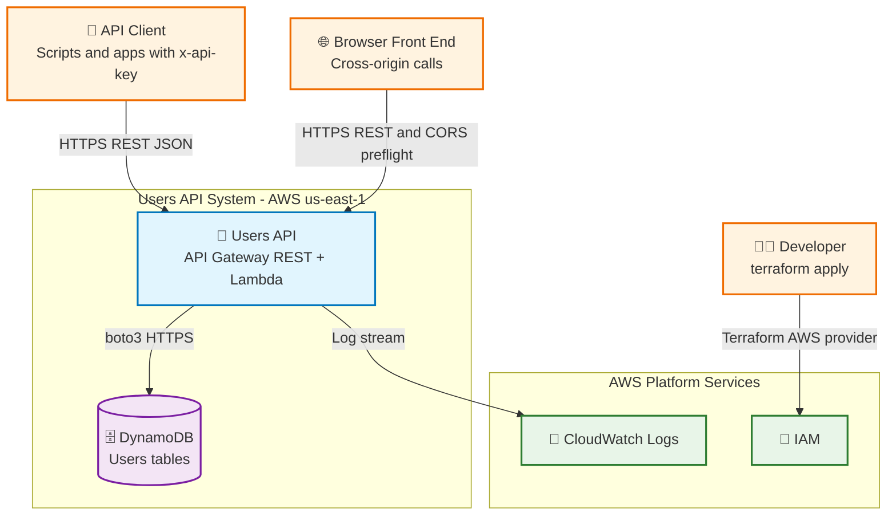
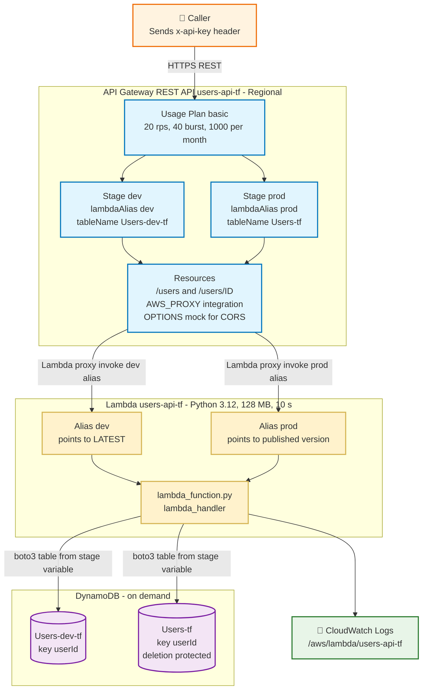
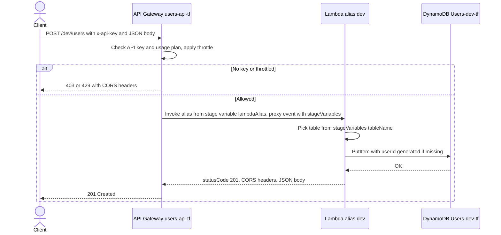
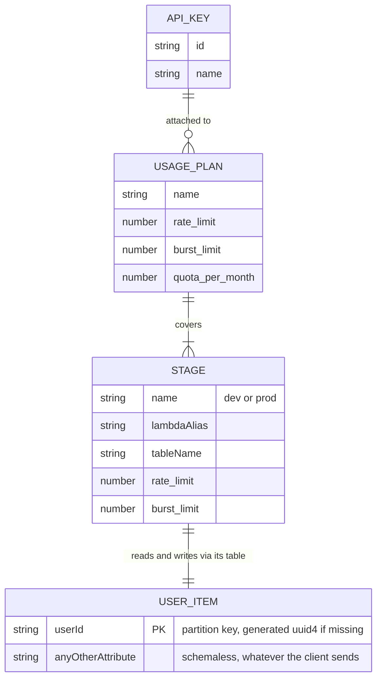

# Architecture Brief: Users API (API Gateway + Lambda + DynamoDB)

**Last Updated:** 2026-11-16
**Validation:** Complete ✅
**Source of truth:** the Terraform in this folder (`versions.tf`, `variables.tf`, `dynamodb.tf`, `lambda.tf`, `api.tf`, `outputs.tf`) and `src/lambda_function.py`.

## Table of Contents

1. [Overview](#1-overview)
2. [Problem Definitions and Business Context](#2-problem-definitions-and-business-context)
3. [C4 System Context Diagram](#3-c4-system-context-diagram)
4. [System Overview](#4-system-overview)
5. [Technology Stack](#5-technology-stack)
6. [System Data Models](#6-system-data-models)
7. [API Endpoints](#7-api-endpoints)
8. [Deployment Architecture](#8-deployment-architecture)
9. [Round 1 Validation Findings](#9-round-1-validation-findings)
10. [Round 2 Validation Findings](#10-round-2-validation-findings)
11. [Round 3 Validation Findings](#11-round-3-validation-findings)
12. [Validation Summary](#12-validation-summary)

---

## 1. Overview

The Users API is a serverless REST service for user management (create, read, update, delete, list). Client applications call it over HTTPS with an API key. It runs as an Amazon API Gateway REST API that invokes a single Python AWS Lambda function, which stores users in Amazon DynamoDB.

There are two stages, `dev` and `prod`. Each stage has its own Lambda alias, DynamoDB table and throttle limits, so test data never reaches production data.

This is Week 4, use case 1 of a mentorship program. The same system was first built in the AWS Console and CLI. This Terraform reproduces it as code, in a separate set of resources (names end in `-tf`).

## 2. Problem Definitions and Business Context

### Problem Statement

- Teams need a managed user store behind an HTTP API without servers to patch or scale.
- Dev and prod must be isolated, with prod changes promoted deliberately.
- Clients must be rate-limited so one caller cannot exhaust the backend.
- Browser front ends need CORS to work, including on error responses.
- The Console-built version is not reproducible, so it needs to be expressed as code.

### Primary Users and Use Cases

| User | Use case |
|---|---|
| API client apps and scripts | Create, read, update, delete and list users with an API key |
| Browser front ends | Call the API cross-origin, using the preflight `OPTIONS` request |
| Developer or mentee | Deploy and test the stack in `dev`, then promote to `prod` |
| Operator | Review throttling, quotas and logs |

### Non-Functional Requirements

| Area | Requirement as implemented |
|---|---|
| Availability | Regional API Gateway, Lambda and DynamoDB, all managed and multi-AZ. No multi-region setup |
| Performance | On-demand DynamoDB, Lambda 128 MB with a 10 s timeout. Account Lambda concurrency is about 10 on a new account, which is the practical limit |
| Security | API key required on all CRUD methods. Lambda role limited to the stage tables. DynamoDB encrypted at rest. No user authentication yet |
| Scalability | Stage throttle 50 rps / 100 burst. Usage plan 20 rps / 40 burst / 1000 requests per month |
| Recoverability | DynamoDB point-in-time recovery. Deletion protection on the prod table |
| Observability | Lambda logs in CloudWatch, 14 days retention. Stage metrics enabled |

### Integration Points

Only integrations present in the code are listed.

| System | Protocol | Purpose |
|---|---|---|
| Amazon DynamoDB | HTTPS, AWS SDK for Python boto3 | User storage |
| Amazon CloudWatch Logs | AWS managed | Lambda log output |
| AWS IAM | AWS managed | Lambda execution role, invoke permissions |

No external third-party systems, authorizers or message queues are integrated. Cognito authentication is a planned next use case and is **not** part of this system.

## 3. C4 System Context Diagram

## 4. System Overview

### Container Diagram

### Component Descriptions

| Component | Defined in | Description |
|---|---|---|
| REST API and resources | `api.tf` | Regional REST API with `/users` and `/users/{id}`. Methods come from `local.methods`, so a new endpoint is one entry |
| Integration | `api.tf` | `AWS_PROXY` to the Lambda alias. The URI ends in `:${stageVariables.lambdaAlias}`, so one integration serves both stages |
| CORS | `api.tf` | `OPTIONS` mock methods with no API key, plus CORS headers on gateway `DEFAULT_4XX` and `DEFAULT_5XX` responses |
| Deployment | `api.tf` | `aws_api_gateway_deployment` with a `triggers` hash of methods, integrations and CORS config, so changes redeploy. `create_before_destroy` |
| Stages | `api.tf` | One per entry in `var.stages`, with stage variables `lambdaAlias` and `tableName`. `method_settings` on `*/*` set throttle and metrics |
| Usage plan and API key | `api.tf` | One plan attached to both stages, one key `users-api-tf-test-client` |
| Lambda function | `lambda.tf` | Python 3.12, `publish = true`, code zipped from `src/lambda_function.py` |
| Aliases | `lambda.tf` | `dev` tracks `$LATEST`, `prod` is pinned to the version published by the apply |
| Invoke permissions | `lambda.tf` | One `aws_lambda_permission` per alias, source ARN `<execution_arn>/*/*/*` |
| IAM role | `lambda.tf` | `AWSLambdaBasicExecutionRole` plus inline policy for GetItem, PutItem, UpdateItem, DeleteItem and Scan on the stage tables only |
| DynamoDB tables | `dynamodb.tf` | One per stage via `for_each`, with point-in-time recovery and encryption |

### Request Flow Sequence

## 5. Technology Stack

| Layer | Technology | Version |
|---|---|---|
| IaC | Terraform | >= 1.5.0 |
| Providers | hashicorp/aws, hashicorp/archive | ~> 5.0, ~> 2.4 |
| Lambda runtime | Python | 3.12 |
| Lambda SDK | boto3 from the Lambda runtime, not bundled | runtime provided |
| API | Amazon API Gateway REST API, Regional endpoint, `AWS_PROXY` | n/a |
| Data | Amazon DynamoDB, on-demand billing, partition key `userId` String | n/a |
| Monitoring | CloudWatch Logs, 14 days retention. API Gateway stage metrics | n/a |
| Security | IAM role with least-privilege inline policy, API keys, DynamoDB SSE | n/a |
| Region | us-east-1 default | `var.region` |

## 6. System Data Models

- **Storage format:** one DynamoDB item per user, JSON-like, keyed only on `userId`. There are no secondary indexes. The handler does not validate attributes.
- **Isolation:** each stage maps to its own table. The mapping is through the `tableName` stage variable, and the Lambda code falls back to a table named `Users` if the variable is missing. That table does not exist in this stack, so a missing variable fails the request.
- **Numbers:** DynamoDB returns `Decimal`. The handler converts them to int or float when building the JSON response.
- **Data flow:** client JSON, then API Gateway proxy event, then Lambda, then DynamoDB item. Responses go back the same way.

## 7. API Endpoints

All CRUD methods require header `x-api-key`. Base URL: `https://<api-id>.execute-api.us-east-1.amazonaws.com/<stage>`.

### Public: user management

| Method | Path | Success | Errors | Notes |
|---|---|---|---|---|
| GET | `/users` | 200, JSON array | 403, 429 | Full table scan, first page only |
| POST | `/users` | 201, created item | 400 invalid JSON | Generates `userId` if not given |
| GET | `/users/{id}` | 200, item | 404 | |
| PUT | `/users/{id}` | 200, item | 400 invalid JSON | Replaces the whole item and creates it if missing |
| DELETE | `/users/{id}` | 204, empty body | | Idempotent |

### CORS preflight

| Method | Path | Result |
|---|---|---|
| OPTIONS | `/users`, `/users/{id}` | 200 with `Access-Control-Allow-Origin`, `-Headers`, `-Methods`. No API key needed |

### Authentication

None beyond the API key. The key identifies a client for throttling and quota and is not user authentication. There is no authorizer yet.

### Internal and other

The handler returns 405 for any other method. There are no internal or admin endpoints.

## 8. Deployment Architecture

- **Deployment unit:** one Lambda function, one zip package built by Terraform `archive_file` into `build/users-crud.zip`. There are no container images.
- **Environments:** `dev` and `prod` stages in one API. Stage variables choose the alias and table.
- **Promotion:** `dev` runs `$LATEST`. `prod` runs the version published at apply time (`aws_lambda_function.users.version`).
- **Scaling:** API Gateway and DynamoDB on-demand scale automatically. Lambda scales per request but is capped by account concurrency (about 10 on a new account). The throttles protect the backend and are best-effort.
- **Network:** public Regional API Gateway endpoint over HTTPS. Lambda is not in a VPC and reaches DynamoDB through the AWS public endpoint.
- **State and secrets:** Terraform state holds the API key value in plain text. `.gitignore` excludes it. A remote backend is not configured.
- **Deploy:** `terraform init`, `plan`, `apply`. Destroy requires turning off the prod table deletion protection first.
- **Resilience:** managed services handle AZ failure. There is no cross-region failover.

---

## 9. Round 1 Validation Findings

Gap analysis. Gaps found and how they were fixed in this document:

1. The brief did not state that the `Users` fallback table does not exist in this stack. Added to section 6.
2. Scaling units and Lambda concurrency were not described. Added to sections 2 and 8.
3. Error handling was not documented. Added error columns in section 7. Noted that unhandled exceptions, for example a DynamoDB error, surface as API Gateway 500.
4. Monitoring was only mentioned in passing. Specified the log group, retention and stage metrics.
5. No mention of what is not integrated. Added the explicit "no Cognito, no authorizer" statements.
6. Technology versions were partly generic. Pinned Terraform, provider and runtime versions.
7. Diagram syntax was checked against the prompt's rules: subgraph IDs use camelCase with bracketed display names, no parentheses in node labels, no braces or line breaks in edge labels (`/users/ID` is used in labels). Fixed a label in the container diagram that used braces. Every `classDef` matches a `class` line.

## 10. Round 2 Validation Findings

Adversarial review against the code. Challenges and resolutions:

1. **Is there a stage-to-alias binding gap?** An alias needs its own invoke permission. Confirmed `aws_lambda_permission.apigw` is keyed per stage with `qualifier`. Documented.
2. **Does prod really stay stable?** Not entirely: `publish = true` plus `function_version = version` means any code change publishes a new version and moves `prod` in the same apply. There is no approval gate. Documented in section 8 as a limitation.
3. **Is the API key a security control?** No. It is not authentication. Corrected the wording in sections 2 and 7.
4. **Is `GET /users` safe?** It uses `scan()` once with no pagination, so results are truncated at 1 MB and cost grows with table size. Documented in section 7.
5. **Is PUT a true update?** `put_item` replaces the whole item and creates a missing one. Corrected the description from "update" to "replace".
6. **Integration false positives:** checked each listed integration against code. DynamoDB, CloudWatch Logs and IAM are real. No other systems are referenced.
7. **CORS accuracy:** the Lambda sets `Access-Control-Allow-Origin` from `ALLOWED_ORIGIN`. The gateway responses set Origin and Headers only, not Methods. Documented that `*` is for testing.
8. **Single points of failure:** one region, one Lambda function and one API shared by both stages. A bad deployment affects both stages' routing. Documented.
9. **Secret exposure:** the API key appears in state and as a sensitive output. Documented in section 8.

## 11. Round 3 Validation Findings

Stakeholder readiness.

- **Developers:** added file-to-component mapping in section 4 and endpoint behavior in section 7. Run steps are in the folder's `README.md`.
- **Product:** problem statement and use cases are in plain language. Limits stated: no user authentication, no pagination, no schema validation.
- **Operations:** deployment, scaling, concurrency cap and logging are covered. Known gaps: no alarms, no access logs on the stage, no remote state.
- **Security:** auth model, data at rest, least-privilege role, state-file risk and the `*` CORS origin are stated. Recommended next step is a Cognito authorizer (use case 2), tighter origins and a remote backend with locking.
- **Presentation:** table of contents added, terminology kept consistent (stage, alias, table), all placeholders removed, links point to headings in this file.

## 12. Validation Summary

| Round | Result |
|---|---|
| Round 1: gaps and completeness | 7 gaps found and fixed |
| Round 2: adversarial challenge | 9 challenges checked against the code, with 5 corrections or documented limitations (prod promotion, API key, scan, PUT semantics, state secret) |
| Round 3: stakeholder readiness | Reviewed for developer, product, operations and security readers, with limits and next steps added |

All 3 rounds completed. Validation: Complete ✅

Limitation of this validation: Terraform is not installed in the authoring environment. The brief was checked against the files and against the observed `apply` and `curl` results in the session, not by re-running `terraform validate`.
